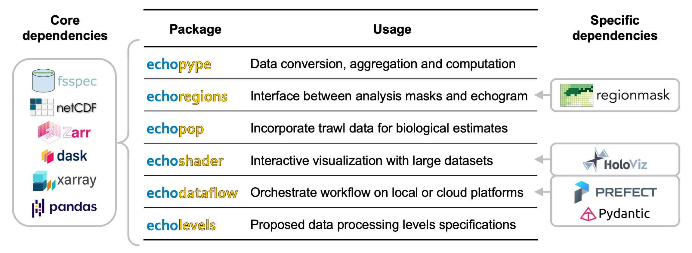

# echostack

**echostack** is an open-source ecosystem of interoperable Python packages for processing, analyzing, visualizing, and managing scientific echosounder data.

The ecosystem provides modular and scalable software components for working with water-column sonar data, from raw instrument files to calibrated, analysis-ready data products and downstream ecological interpretation.

  

Built on the Scientific Python ecosystem, Echostack leverages libraries such as **xarray**, **Dask**, **Zarr**, **NetCDF**, **fsspec**, and **pandas**, while integrating with community projects including **regionmask**, **HoloViz**, **Prefect**, and **Pydantic**.

## Core repositories

| Repository | Description | Activity |
| --- | --- | --- |
| [**echopype**](https://github.com/echostack-org/echopype) | Data conversion, calibration, aggregation, and computation for echosounder data. |   |
| [**echopype-examples**](https://github.com/echostack-org/echopype-examples) | Example notebooks and tutorials demonstrating the Echostack ecosystem. |   |
| [**echoregions**](https://github.com/echostack-org/echoregions) | Interfaces echosounder data with annotations, lines, regions, and masks. |   |
| [**echopop**](https://github.com/echostack-org/echopop) | Combines acoustic and biological data for population and biomass estimates. |   |
| [**echoshader**](https://github.com/echostack-org/echoshader) | Interactive visualization of large echosounder datasets. |   |
| [**echodataflow**](https://github.com/echostack-org/echodataflow) | Workflow orchestration for local and cloud-based echosounder processing pipelines. |   |
| [**echodataflow-recipes**](https://github.com/echostack-org/echodataflow-recipes) | Example recipes and configurations for Echodataflow workflows. |   |
| [**echolevels**](https://github.com/echostack-org/echolevels) | Proposed processing-level specifications for standardized echosounder data products. |   |

## Design principles

The Echostack ecosystem is designed to be:

- **Modular**: repositories can be used independently or combined into larger workflows.
- **Interoperable**: built upon the Scientific Python ecosystem and common open data formats.
- **Scalable**: from personal laptops to HPC clusters and cloud platforms.
- **Open**: community-driven, reproducible, and open-source.

## Scientific publication

A complete overview of the project's motivation, architecture, design principles, and example workflows is available in the SciPy Proceedings paper:

> **[Echostack: A flexible and scalable open-source software suite for echosounder data processing](https://proceedings.scipy.org/articles/WXRH8633)**

## Community

We welcome contributions from researchers, developers, and users of ocean acoustic data.

- For package-specific bugs, feature requests, or documentation improvements, please open an issue or pull request in the relevant repository.
- For cross-repository discussions, shared standards, or organization-wide initiatives, use the **`.github`** repository.